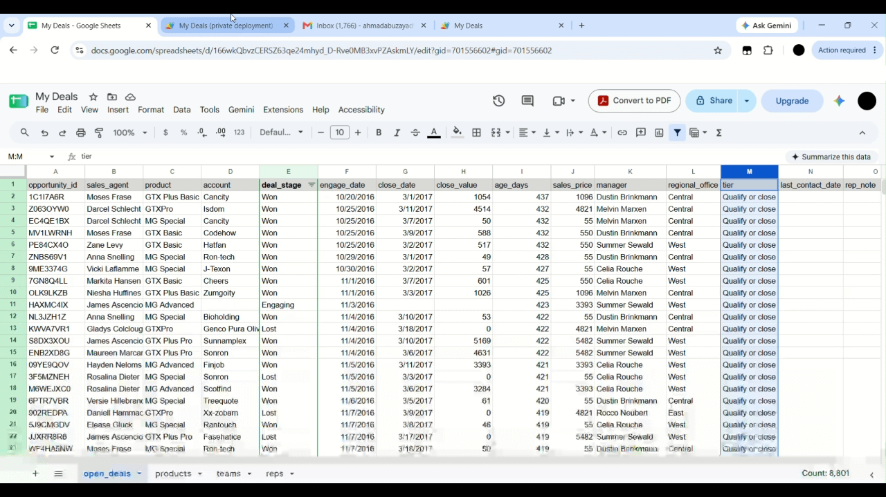
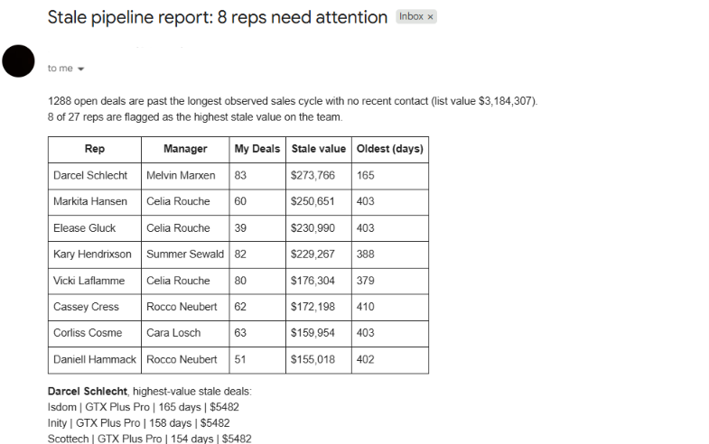
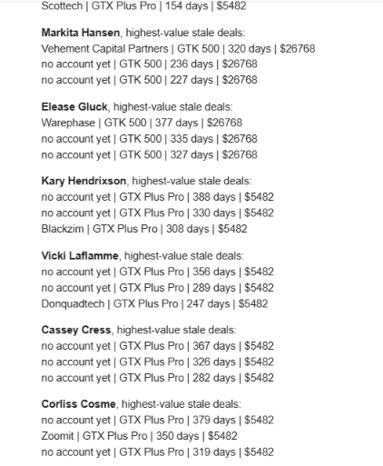
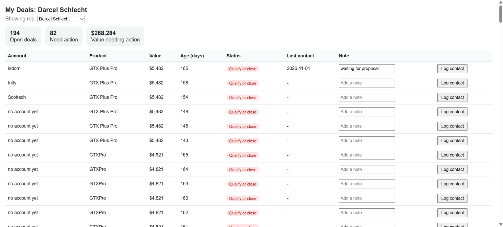

# Stale Deal Tracker

A weekly email and web dashboard that show a sales manager which reps have the most money sitting in stale deals. Built with Google Sheets and Google Apps Script, using public CRM sample data. The stale-deal cutoffs come from a Python analysis of deals that already closed.



## The problem

In a spreadsheet of open deals, it's hard to see which ones have gone quiet. A manager has to filter, sort and check dates by hand to find them, and by then the deal may be dead. This project does that check automatically and puts the answer in front of the manager every Monday.

## What it does

**1. Monday report email.** Every Monday, a script reads the open deals, finds the stale ones, adds up their value per rep, and emails the manager a summary:
- how many open deals are stale, and their total value
- the reps with the most stale value (the top quarter by value)
- for each flagged rep: deal count, total stale value, oldest deal, and their three highest-value stale deals




**2. Manager dashboard.** A web page where the manager can:
- switch between reps with a dropdown
- see open deals, deals needing action, and the value needing action
- see each deal's account, product, value, age, status (color-coded), last contact and note
- click **Log contact** to record a contact date and a note, which updates the spreadsheet and takes the deal off the "needs action" list



## How a deal is judged stale

Each open deal gets a status from its age, measured in days since the first engagement:

| Status | Age | Meaning |
|---|---|---|
| On track | 88 days or less | Moving normally |
| Check in | 89 to 138 days | Taking longer than most closed deals |
| Qualify or close | Over 138 days | Past the longest cycle seen on any closed deal |
| Not engaged yet | No engagement date | Prospecting deals. With no start date there is no age, so staleness is not assessed |

A deal **needs action** when:
1. its status is `Qualify or close`, and
2. it has no logged contact in the last 7 days.

Logging a contact takes the deal off the list for 7 days. After that it returns, unless it has been contacted again.

### Where 88 and 138 come from

The two cutoffs are not guesses. They come from the deals in this dataset that already closed (see [`notebook/threshold_analysis.ipynb`](notebook/threshold_analysis.ipynb)):

- **88 days** is the 75th percentile of days from first engagement to close, among **won** deals. Three out of four won deals closed within this time.
- **138 days** is the longest engagement-to-close cycle among **all closed** deals, won or lost. An open deal older than this has been open longer than any deal in the data ever took to finish.

The notebook then applies these cutoffs to the 2,089 open deals (stages `Engaging` and `Prospecting`):

| Status | Open deals | Value |
|---|---|---|
| On track | 108 | $221,619 |
| Check in | 190 | $471,946 |
| Qualify or close | 1,291 | $3,198,664 |
| Not engaged yet | 500 | $1,073,986 |

All 500 Prospecting deals have no engagement date, so they can't be aged. Of the 1,589 deals that can be judged, 1,291 (81%) are past the 138 day cutoff. Because the stale list is so long, the report ranks reps by the dollar value of their stale deals, and flags the top quarter, instead of listing every rep with a stale deal.

Among deals with an age, six reps have every open deal past the cutoff, and stale share by manager ranges from 73% to 99%. These shares leave out the Prospecting deals, which can't be judged.

Deal values are estimates from product list prices, and 14 of the 15 highest-value stale deals are the same product (GTK 500, $26,768 each), so a handful of deals account for much of the stale dollar value.

**Limits of this method**
- The cutoffs use only deals that have closed. Deals that are still open and old aren't counted, so the real sales cycle may be longer.
- The 138 day cutoff is set by a single longest closed deal, so one outlier moves it.
- The data is from 2016 and 2017, so the cutoffs describe that sales team and that period. Use your own history to set them for a real pipeline.

## How it works

```
Google Sheet  ──►  Apps Script (Code.gs)
 open_deals         ├─ sendManagerReport()  ──► weekly email (time trigger, Mondays)
 reps               ├─ getPageData()        ──► feeds the dashboard
 teams              └─ logContact()         ◄── "Log contact" button on the dashboard
 products                     ▲
                      index.html (dashboard)

notebook/threshold_analysis.ipynb  ──►  88 and 138 day cutoffs used in the sheet's tier formula
```

- **The notebook** works out the cutoffs from closed deals.
- **Sheet formulas** calculate age, price, manager, region and status using those cutoffs.
- **Apps Script** reads the sheet, applies the stale-deal rules, sends the email and serves the web page.
- **The dashboard** reads through `getPageData()` and writes through `logContact()`.

## Data

Source: [Maven Analytics CRM Sales Opportunities](https://mavenanalytics.io/data-playground/crm-sales-opportunities) (public sample data). Three of its files are used, kept unmodified in `data/raw/`:

| File | Spreadsheet tab | Used for |
|---|---|---|
| `sales_pipeline.csv` | `open_deals` (columns A to H) | One row per deal: agent, product, account, stage, dates |
| `sales_teams.csv` | `teams` | Each rep's manager and regional office |
| `products.csv` | `products` | Each product's list price |

### Columns added in the spreadsheet

Columns I to O of `open_deals` are formulas, or are filled by the script:

| Column | How it is filled |
|---|---|
| `age_days` | 31 Dec 2017 minus `engage_date` (blank when there is no engage date) |
| `sales_price` | Product list price, looked up from `products` |
| `manager`, `regional_office` | Looked up from `teams` by sales agent |
| `tier` | `On track`, `Check in`, `Qualify or close` or `Not engaged yet` (cutoffs above) |
| `last_contact_date`, `rep_note` | Written by the dashboard's Log contact button |

The `reps` tab is the unique list of agents with open deals. It fills the dashboard dropdown.

### Things to know about the data

- **Dates.** The deals are from 2016 and 2017, so age is measured against a fixed reference date (31 Dec 2017) instead of today's date. Using today's date would make every deal look years old.
- **Open deals.** Deals in the `Engaging` and `Prospecting` stages count as open. The sheet still contains Won and Lost rows, and the script ignores them by filtering on `deal_stage`. Prospecting deals have no engagement date, so they have no age and show as "Not engaged yet" instead of being judged stale.
- **Deal value is an estimate.** Open deals have no `close_value`, so value comes from the product's list price. Won deals in the data closed slightly away from list price, so real values would differ.
- **Product names.** One product is written `GTXPro` in the deals and `GTX Pro` in the products file. The price formula and the notebook both handle this.
- **Missing accounts.** Some early-stage deals have no account name. The dashboard shows "no account yet".

## Setup

### 1. Build the spreadsheet

1. Create a Google Sheet and import the three CSV files into tabs named exactly:
   `open_deals` (from `sales_pipeline.csv`), `teams` (from `sales_teams.csv`) and `products` (from `products.csv`).
2. Import into a **new** spreadsheet and check that `engage_date` shows as right-aligned dates. Importing into an existing sheet can turn dates into text and break the age formula.
3. In `open_deals`, add these headers in `I1:O1`, spelled exactly like this:

   `age_days`, `sales_price`, `manager`, `regional_office`, `tier`, `last_contact_date`, `rep_note`

4. Put one formula in row 2 of each column. Don't drag them down. Each one fills its whole column.

   `I2` (age_days):
   ```
   =ARRAYFORMULA(IF(A2:A="",,IF(F2:F="","",DATE(2017,12,31)-F2:F)))
   ```
   `J2` (sales_price):
   ```
   =ARRAYFORMULA(IF(A2:A="",,IFERROR(VLOOKUP(SUBSTITUTE(C2:C,"GTXPro","GTX Pro"),products!A:C,3,FALSE),0)))
   ```
   `K2` (manager):
   ```
   =ARRAYFORMULA(IF(A2:A="",,IFERROR(VLOOKUP(B2:B,teams!A:C,2,FALSE),"")))
   ```
   `L2` (regional_office):
   ```
   =ARRAYFORMULA(IF(A2:A="",,IFERROR(VLOOKUP(B2:B,teams!A:C,3,FALSE),"")))
   ```
   `M2` (tier):
   ```
   =ARRAYFORMULA(IF(A2:A="",,IF(I2:I="","Not engaged yet",IF(I2:I>138,"Qualify or close",IF(I2:I>88,"Check in","On track")))))
   ```
   Leave `N` and `O` empty. The script fills them.

5. Create a tab named `reps`. Put `sales_agent` in `A1` and this in `A2` (nothing below it):
   ```
   =SORT(UNIQUE(FILTER(open_deals!B2:B, (open_deals!E2:E="Engaging")+(open_deals!E2:E="Prospecting"))))
   ```
6. Optional: filter `deal_stage` in `open_deals` to show only `Engaging` and `Prospecting`. This only changes what you see in the sheet. The script does its own filtering.

### 2. Add the script

1. In the spreadsheet, open **Extensions → Apps Script**.
2. Paste `apps-script/Code.gs` into `Code.gs`.
3. Add an HTML file named `index` and paste `apps-script/index.html` into it.
4. In `CONFIG`, set `managerEmail` to your own address.

### 3. Deploy the dashboard

**Deploy → New deployment → Web app**
- Execute as: **Me**
- Who has access: **Only myself**

After any code change, use **Deploy → Manage deployments → Edit → New version**. Saving alone doesn't update the live page.

### 4. Schedule the Monday email

1. Open **Triggers** (the clock icon) and click **Add Trigger**.
2. Function: `sendManagerReport`
3. Event source: **Time-driven**, type **Week timer**, day **Every Monday**, and pick an hour.
4. Authorize the script when asked.

To test now, select `sendManagerReport` in the editor toolbar and click **Run**.

## Configuration

Set in `CONFIG` at the top of `Code.gs`:

| Setting | Default | What it does |
|---|---|---|
| `managerEmail` | `manager@example.com` | Who receives the Monday report |
| `staleTier` | `Qualify or close` | The status that counts as stale |
| `remindAfterDays` | `7` | Days a logged contact removes a deal from the list |
| `extremePercentile` | `0.75` | Flags reps in the top quarter by stale value |
| `topDealsPerRep` | `3` | Deals listed per flagged rep in the email |
| `openStages` | `Engaging`, `Prospecting` | Deal stages treated as open |

The 88 and 138 day cutoffs are not in `CONFIG`. They are in the `tier` formula (column M of `open_deals`). To use different cutoffs, change the numbers there.

## Running the notebook

`notebook/threshold_analysis.ipynb` reproduces the cutoffs and the stale-share breakdowns.

1. Put `sales_pipeline.csv`, `sales_teams.csv` and `products.csv` in `data/raw/`.
2. Install pandas (`pip install pandas`) and run the notebook top to bottom.
3. It prints the two cutoffs (88 and 138), the open deals by stage, the tier breakdown, stale share by rep and by manager (among deals that have an age), and the 15 highest-value stale deals.

## Public read-only version (optional)

To share a live demo without giving write access, make a second Apps Script project bound to the same sheet, using the files in `apps-script/read-only/`. It has no `logContact` and no `sendManagerReport`, so the page can only read.

- Execute as: **Me**
- Who has access: **Anyone**
- Don't add the Monday trigger to this project.

This version has no sign-in, so anyone with the link sees every rep's deals. Use it only with public or sample data, as here.

Live demo: [open the read-only dashboard](PASTE-PUBLIC-DEPLOYMENT-URL)

## Limitations

- **Manager only.** There's no rep sign-in. Reps can't log their own contacts, so the manager or whoever has access logs them. Letting each rep log their own calls would be the next step.
- **Access control is deployment-level.** The private dashboard is protected by "Only myself". There's no per-user check in the code.
- **Estimated value.** Value uses list price, not negotiated price.
- **Fixed reference date.** Age is measured from 31 Dec 2017 because of the dataset's age.
- **Cutoffs from closed deals only.** See "Limits of this method" above.
- **Prospecting deals aren't assessed.** They have no engagement date, so they can't be judged stale.
- **Read speed.** The script reads the whole `open_deals` tab each time. This is fine at a few thousand rows and gets slow in the tens of thousands.

## Project structure

```
stale-deal-tracker/
├── README.md
├── LICENSE
├── apps-script/
│   ├── Code.gs
│   ├── index.html
│   └── read-only/
│       ├── Code.gs
│       └── index.html
├── notebook/
│   └── threshold_analysis.ipynb
├── data/
│   └── raw/
│       ├── sales_pipeline.csv
│       ├── sales_teams.csv
│       └── products.csv
└── images/
    ├── email-report.png
    ├── dashboard.png
    └── demo.gif
```

## Troubleshooting

- **Dashboard shows old behavior after an edit.** Create a **New version** in Manage deployments.
- **Log contact does nothing.** Check that the `open_deals` headers are exactly `opportunity_id`, `last_contact_date` and `rep_note`, and that no header cell is blank. Open the web app in a private window signed into only the owning Google account.
- **All values are $0.** The `products` tab is missing, or a product name doesn't match.
- **Age formula errors.** `engage_date` was imported as text. Re-import into a new spreadsheet.
- **A rep shows no deals.** They may have no open deals. Check `open_deals` for their name.
- **Dashboard counts differ from the notebook.** Check that `openStages` in `CONFIG` is `["Engaging", "Prospecting"]` and that both use the same reference date. The notebook's stale share leaves out Prospecting deals, and the dashboard's "Open deals" chip includes them.

## Tech

Python (pandas) for the analysis. Google Sheets, Google Apps Script (JavaScript), HTML and CSS for the tool.

## Data Source

Data: [Maven Analytics, CRM Sales Opportunities](https://mavenanalytics.io/data-playground/crm-sales-opportunities)
